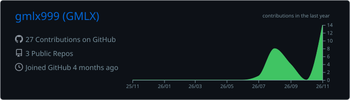
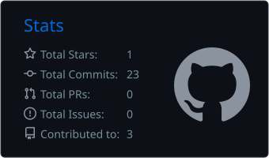
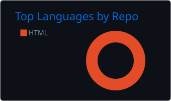
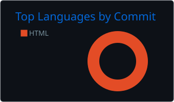

<!--
  GMLX · MONOCHROME EDITION v3
  Todos los "&" dentro de src="" van como "&amp;" (GitHub rompe "&section" y "&center" si no).
-->

<div align="center">

<!-- BANNER -->


<!-- TYPING -->
<a href="https://github.com/gmlx999">
  
</a>

<br/>

<!-- BADGES -->

<a href="https://github.com/gmlx999?tab=followers"></a>
<a href="https://github.com/gmlx999/gmlx-downloader"></a>
<a href="https://github.com/gmlx999/gmlx999/commits/main"></a>
<a href="https://discord.gg/gmlx"></a>

</div>

<br/>

---

### `> 00 // BOOT`

```text
  ____ __  __ _     __  __
 / ___|  \/  | |    \ \/ /
| |  _| |\/| | |     \  /
| |_| | |  | | |___  /  \
 \____|_|  |_|_____|/_/\_\

gmlx@github
-----------
role     : Full Stack Developer
focus    : AI apps · FiveM systems · tooling
langs    : Python · Node.js · C++ · C# · Lua
shop     : gmlx-store.vercel.app
discord  : .gmlx.
status   : building in public
```

<br/>

---

### `> 01 // WHAT I DO`

<div align="center">
<table>
  <tr>
    <td align="center" width="33%">
      <h4><code>FULL STACK</code></h4>
      Apps web de punta a punta:<br/>
      React · Next.js · Node.js<br/>
      Bases de datos y despliegue
    </td>
    <td align="center" width="33%">
      <h4><code>FIVEM</code></h4>
      Sistemas y scripting<br/>
      Lua · lógica de servidor<br/>
      Herramientas y loaders
    </td>
    <td align="center" width="33%">
      <h4><code>AI APPS</code></h4>
      Aplicaciones con IA<br/>
      Python · APIs · automatización<br/>
      Ideas que se vuelven producto
    </td>
  </tr>
</table>
</div>

<br/>

---

### `> 02 // SOCIALS`

<div align="center">
  <a href="https://www.instagram.com/derek_.try/">
    
  </a>
  &nbsp;&nbsp;
  <a href="https://tiktok.com/@gmlxstore.shopify.com">
    
  </a>
  &nbsp;&nbsp;
  <a href="https://discord.gg/gmlx">
    
  </a>
  &nbsp;&nbsp;
  <a href="https://guns.lol/4gemelo4">
    
  </a>
  <br/><br/>
  <code>DISCORD: .gmlx.</code>
</div>

<br/>

---

### `> 03 // FEATURED PROJECTS`

<div align="center">

| Project | What it is | Stack |
| :--- | :--- | :--- |
| [**gmlx-downloader**](https://github.com/gmlx999/gmlx-downloader) | YouTube downloader, open source | `HTML` |
| [**gmlx-loader**](https://github.com/gmlx999/gmlx-loader) | Loader project | `Lua` · `C++` |
| [**gmlx-store**](https://gmlx-store.vercel.app/) | Online store, live on Vercel | `Next.js` · `Tailwind` |

</div>

<br/>

---

### `> 04 // TECH STACK`

<div align="center">

**Languages & Frontend**


**Backend & Data**


**Tools & Systems**


</div>

<br/>

---

### `> 05 // GITHUB METRICS`

<div align="center">
  <!-- Estas tarjetas las genera .github/workflows/profile-cards.yml (sin servidores externos) -->
  
  
  <br/>
  
  
  <br/><br/>
  
</div>

<br/>

---

### `> 06 // CONTRIBUTION SNAKE`

<div align="center">
  
</div>

<br/>

---

### `> 07 // CONTACT`

<div align="center">

`> let's build something.`

<br/>

<a href="https://discord.gg/gmlx"></a>
<a href="https://gmlx-store.vercel.app/"></a>

<br/><br/>


</div>
